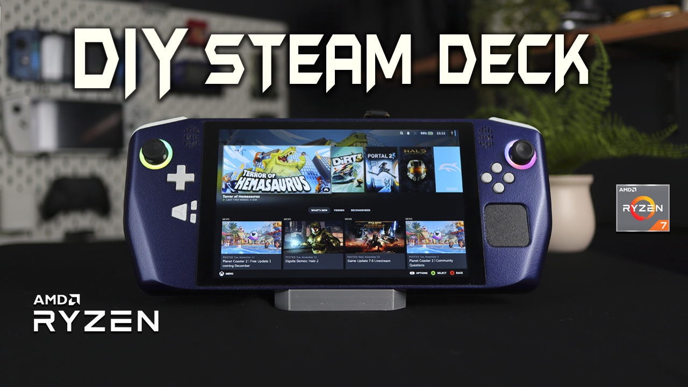

# ZenDeck

<h3 align="center">
This is a hard-fork of CNCDan's fantastic ZenDeck project, which incorporates a Ryzen-powered Mini-PC into a custom-built handheld gaming console!
</h3>

## Acknowledgement

The majority of this work is based on the previous work of CNCDan (see the upstream repo!). As such, my adjustments would not have been possible without many months of development on his end. If you find that this work benefits you or inspires you to make your own ZenDeck, please take a look at his original project -- as well as his other works -- and show him your support!

**CNCDan's Youtube:**
https://www.youtube.com/@cncdan

**CNCDan's Original ZenDeck Development Log:**
https://www.youtube.com/watch?v=_ST59qbFj8Q&list=PLy9j9_dmmg2TrMOIG65j3nOELqgDXPkkn

 

## Info

This repository intends to serve as a build diary and general knowledge-base for my specific implementation of the ZenDeck, in the hopes that the details of my attempt are helpful to others interested in constructing one.
I had started my implementation a few months before forking the repository, so some details are not part of the commit history; however, **there is still quite a bit to finish**, and future changes/updates will be recorded here.

Please note that this is not a one-to-one recreation -- I have made several design changes to better suit my use-case. The major points are provided in this readme, but smaller changes are described in more detail in each directory.

## Features

- Customizable mounting system for other Mini-PCs
- 8" 1280x800 60hz IPS display (with touch)
- Full-sized Hall effect Joysticks
- Hall effect Triggers
- Full-sized rumble motors *[IN PROGRESS]*
- IMU/Gyroscopic aim-assist *[IN PROGRESS]*
- Custom USB HID-based controller using LUFA
- Trackpad
- Room for up to 88.8Wh battery capacity (using 6000mah 21700 cells).
- USB-C Charging, power path management and OS integration over USB for battery capacity reporting

## Major Design Changes

The following is a (non-exhaustive) list of high-level design changes I've made from the original design. For more information on smaller details changed, please see the individual section readmes and the commit log.
- Mini-PC: Beelink SER5 Max L (Ryzen 7 6800H, 32GB RAM)
- 2-microcontroller control design instead of 3
  <!-- - To conserve on cost and complexity, I have opted to remove the RHS microcontroller in favor of completely running the controller inputs off of a single Atmega32u4. This also allows me to fit all PCB uC USB connections on a single HS8836A for on-the-go reprogramability. -->
- Pure AVR C instead of Arduino.h
- Higher power BMS (19V, 5A) *[IN PROGRESS]*
- Replacement of the TRRS port with an I2C bus header

## Progress
*[COMING SOON]*

## License

This project is licensed under the **CERN Open Hardware Licence Version 2 – Strongly Reciprocal** (CERN-OHL-S-2.0), similar to and as directed by the upstream repository.
A copy of the full license is available in the [license](Licence) file.